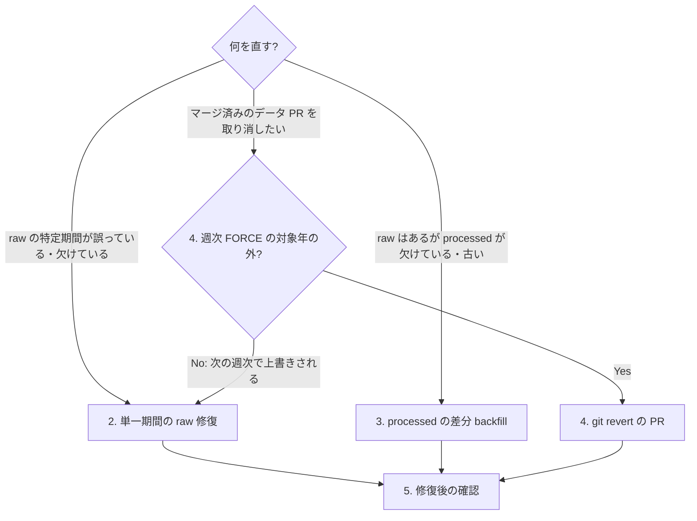

# データ修復・backfill・ロールバック手順書

`data/` の raw (Shift_JIS 原本) と processed (UTF-8 正規化版) を、単一期間だけ取り直す・processed の欠けを埋める・誤ったデータ PR を取り消すときの手順です。どの手順も「確認 → 実行 → 検証」の順に書いています。

## 1. 前提と注意

- **データ提供元への接続**: `fetch-data` は、GitHub Actions のワークフロー (`fetch-data.yml` / `fetch-data-daily.yml` / `fetch-data-weekly.yml`) でもローカルの `uv run fetch-data` でも、データ提供元 (`survey.tmiph.metro.tokyo.lg.jp`) に HTTP リクエストを送ります。`--dry-run` (ワークフローの `dry_run`) を付けても取得は行い、保存と PR 作成だけを省きます。期間・データタイプ・対象週/月を必ず絞ってください。
- **使わない操作**: 次の操作は対象が全件に広がるため、修復の手順としては使いません。
  - `uv run process-data --all` と、`target_files` を空欄にした `process-data.yml` (空欄は `--all` と同じ)
  - 引数なしの `uv run fetch-data` (`config/config.yml` の `collection.start_year` から当年までの全データタイプを要求する)
  - `data_types` や期間を省略した `mode=force` の取得
- **実行するのは人**: `fetch-data` の実行 (`--dry-run` を含め、データ提供元に接続する)、取得ワークフローの dispatch、ワークフローの無効化・再有効化、実 `data/` の書き換えは、人の明示的な指示がある場合に人が行います。エージェントはこれらを実行しません (AGENTS.md の Safety)。
- **作業は PR 経由**: ブランチを切って作業し、PR で反映します。main へ直接 push しません。データ PR のマージは人が行います (手動実行のワークフローは既定で自動マージしません)。
- **実データを書き換える手順**: 2.2・3.2・4 の手順はリポジトリの `data/` を書き換えます。始める前に `git status` が clean であることを確かめてください。`process-data` / `check-data-status` を試すときは `--data-dir` に scratch コピーを指定できます。`fetch-data` には `--data-dir` が無く、保存先は `--config` で渡す設定の `storage.base_directory` で決まります。
- **定期実行との競合**: 取得系の3ワークフローは concurrency グループ `fetch-data` を共有するので、手動の取得中は日次・週次が待ちます。ローカルで作業している間も定期実行は main に PR を作り続けるため、push 前に `git fetch origin` で main の進みを確認してください。



## 2. 単一期間の raw 修復

上流のデータが改訂された・取得に失敗した・欠けている期間を、その期間だけ取り直します。

### 2.1 GitHub Actions の fetch-data.yml で取り直す (推奨)

Actions タブで **📊 東京都感染症データ取得(手動実行)** (`fetch-data.yml`) を選び、次の入力で実行します。`target_weeks` / `target_months` を指定するときは `mode=force` と `data_types` が必須で、満たさないと入力検証で失敗します。`target_weeks` は月次データを絞らないので、週次と月次のデータタイプは別々の run に分けてください。

| 入力            | 値の例                | 説明                                                |
| --------------- | --------------------- | --------------------------------------------------- |
| `data_types`    | `sentinel_weekly_age` | 対象のデータタイプ (カンマ区切り)。空欄にしない     |
| `start_year`    | `2026`                | 対象年。`end_year` と同じ値にして 1 年に絞る        |
| `end_year`      | `2026`                | 対象年                                              |
| `target_weeks`  | `37`                  | 週次データの対象週 (カンマ区切り)。月次なら空欄     |
| `target_months` | (空欄)                | 月次データの対象月 (カンマ区切り)。週次なら空欄     |
| `mode`          | `force`               | 既存ファイルも取り直す。`target_*` 指定時は必須     |
| `dry_run`       | `true` → `false`      | 最初は `true` で対象を確認し、次に `false` で本実行 |
| `auto_merge`    | `false` (既定)        | 修復 PR は人がレビューしてからマージする            |

1. **確認**: `dry_run=true` で実行します (データ提供元に接続します。保存・処理・PR 作成はしません)。ジョブの "Prepare fetch parameters" と "Fetch epidemic data" のログで、対象年・データタイプ・対象週/月が想定どおりか確かめます。
2. **実行**: 同じ入力で `dry_run=false` にして実行します。取得した raw はそのジョブの中で `process-data --files` により processed まで処理され、`data/raw/` に変更があれば PR が作られます。取り直した内容が既存と同じなら変更なしと判定され、PR は作られません。
3. **レビュー**: PR の Files changed で次を確かめます。
   - 変わった raw CSV の数が「指定した期間の数 × データタイプ数」以下で、指定外の期間・データタイプが含まれていない
   - 変わった raw CSV ごとに `data/raw/.metadata/` の JSON と、対応する `data/processed/` の CSV・メタデータがそろっている
   - それ以外の差分は、`README.md` の自動生成ブロックと `docs/images/` の再生成分、`data/processed/stats.json`、その run のタイムスタンプが付いた `data/logs/` の統計・検証ファイル (`stats_<timestamp>.json` / `validation_before_<timestamp>.json` / `validation_<timestamp>.json` のうち、そのワークフローが作るもの) だけ
   - PR 本文の自動マージゲートの結果 (取得・処理・カバレッジ・スキーマ) が不合格になっていない

   想定外のファイルが含まれていればマージせず、原因を調べてください。

### 2.2 ローカルで取り直す (代替)

Actions が使えないときの代替です。ここで示すコマンドはデータ提供元に接続し、リポジトリの `data/raw/` を書き換えます。

1. 最新の main からブランチを切り、作業ツリーが clean であることを確かめます。

   ```bash
   git fetch origin
   git switch -c fix/raw-sentinel-weekly-age-2026-37 origin/main
   git status --short
   ```

2. **確認 (ドライラン)**: 取得対象を確かめます。データ提供元に HTTP リクエストを送りますが、保存はしません。

   ```bash
   # データ提供元に接続する (保存はしない)
   uv run fetch-data --data-types sentinel_weekly_age --start-year 2026 --end-year 2026 --target-weeks 37 --mode force --dry-run
   ```

3. **実行**: 同じ引数から `--dry-run` だけを外して実行します。データ提供元に接続し、指定した期間の raw とメタデータを保存します (`fetch-data` はコミットしません)。

   ```bash
   # データ提供元に接続し、data/raw/ を書き換える
   uv run fetch-data --data-types sentinel_weekly_age --start-year 2026 --end-year 2026 --target-weeks 37 --mode force
   ```

4. 変わったファイルを確かめます。指定した期間の CSV とそのメタデータ以外が出たら、コミットせずに原因を調べてください。何も出なければ、上流の内容は既存と同じです。

   ```bash
   git status --short data/raw
   ```

   `fetch-data` は実行ごとに `data/logs/stats_<timestamp>.json` も作ります (定期実行の PR と同じく、取得の記録としてコミットしてかまいません)。

5. 変わった raw だけを processed に反映し (3.2 と同じ `process-data --files`)、「5. 修復後の確認」を行ってから、変更したパスを明示して `git add` し、PR を作ります。

   ```bash
   uv run process-data --files data/raw/sentinel_weekly_age_2026_37.csv
   ```

## 3. processed の差分 backfill

raw はあるのに processed が欠けている、または raw の改訂後に再処理されていない場合に、対象の raw だけを処理します。

### 3.1 対象の一覧を作る (オフライン)

`check-data-status` はリポジトリ内のファイルを読むだけで、データ提供元には接続しません。`--list-needs-processing` は再処理で直せる raw のパス (`data/raw/<name>.csv`) を 1 行 1 件で出力します。

```bash
LIST="$(mktemp)"
uv run check-data-status --list-needs-processing > "$LIST"
wc -l < "$LIST"
```

- 0 件なら backfill は不要です。`--all` に切り替えないでください。一覧が空でも、再処理では直せない raw (名前が想定外・処理できない内容など) は一覧に出ないので、`uv run check-data-status --fail-on-incomplete; echo "rc=$?"` が `rc=0` で終わることも確かめます。`rc=1` なら `uv run check-data-status --verbose` で理由を確かめます。理由ごとの直し方は次のとおりで、どれも再処理 (`process-data`) では直りません。
  - `unprocessable_raw_content` (内容を処理できない): 上流から取り直す (「2. 単一期間の raw 修復」)
  - `unsupported_raw_filename` (命名規則 `<data_type>_<yyyy>_<nn>.csv` に合わない) / `noncanonical_raw_path` (`data/raw/` 直下にない): 既存のファイルは再取得だけでは直らない。正しい名前・場所のファイルが既にあるか確かめ、規約外のファイルの移動・削除は人が判断して PR で行う。正しいファイルが無ければ「2. 単一期間の raw 修復」で取り直す
- 全件規模の再生成は issue #738 の扱いで、この手順の対象外です。

### 3.2 処理する

**GitHub Actions (推奨)**: **⚙️ データ処理(raw→processed変換・手動実行)** (`process-data.yml`) を使います。入力の意味 (`target_files` は `data/raw/<name>.csv` のカンマ区切りで、空欄は全 raw の `--all` になる)、`dry_run=false` / `verify_output=true` / `auto_merge=false` を明示すること、1 回に渡す件数と入力サイズの上限、前のバッチの PR をマージしてから次を dispatch すること、結果と PR 差分の確認は、[docs/manual-data-processing.md](manual-data-processing.md) の「4. backfill の通常手順」〜「6. マージ後の完全性確認」に従ってください。同書の dispatch 関数は一覧が空なら dispatch せずに止まります。

**ローカル (代替)**: 件数が少なく、ローカルで処理して PR にする場合の手順です。まず引数だけを確認するドライランを実行します (対象ファイルの存在確認・変換・`stats.json` の更新はしません)。

```bash
uv run process-data --dry-run --files data/raw/sentinel_weekly_age_2026_37.csv
```

3.1 と同じシェルで、一覧のファイルを処理します。一覧が空のとき (または `LIST` が未設定のとき) は何もしません (空のまま `process-data` を呼ばない)。件数が多いときは引数長の上限にかかるので、ローカルではなく Actions の手順を使います。

```bash
if [ -n "${LIST:-}" ] && [ -s "$LIST" ]; then
  files=()
  while IFS= read -r f; do files+=("$f"); done < "$LIST"
  uv run process-data --files "${files[@]}"
else
  echo "no raw files need processing; nothing to do"
fi
```

処理後に `git status --short data/processed` で、一覧の raw に対応する processed の CSV とメタデータだけが変わったことを確かめます。`data/processed/stats.json` も書き換わります。処理前に試すときは、manual-data-processing.md の 1 章のとおり `--data-dir` に隔離コピーを指定します。

## 4. データ PR の revert

マージ済みのデータ PR を取り消すときの手順です。データ PR は squash マージなので、1 つのコミットを revert します。

### 4.1 revert が恒久的に効く範囲

- **週次 FORCE の対象年の内側では効かない**: `fetch-data-weekly.yml` は毎週木曜に当年 (1月は前年も) の全データを `force` で取り直し、ゲートを通れば自動マージします。当年分を revert しても、次の週次で上流の内容に上書きされます。
- **日次の取り直し**: `fetch-data-daily.yml` は 2週前・前週・当週と前月・当月の未取得の期間を取得するので、この範囲で revert により削除したファイルは翌日に取り直されます。
- したがって revert が恒久的に効くのは、週次 FORCE の対象年より前の年のデータだけです。当年のデータが上流で誤っているときは、上流が直るまで 4.4 のとおり定期実行を止めるか、上流の修正後に 「2. 単一期間の raw 修復」の手順で取り直してください。

### 4.2 revert の PR を作る

1. **確認**: 取り消すコミットと、そのコミットが変えたファイルを確かめます。

   ```bash
   git fetch origin
   git log --oneline -5 origin/main -- data/raw
   git show --stat <squash-commit>
   ```

2. **実行**: 最新の main からブランチを切って revert します。

   ```bash
   git switch -c revert/data-pr-<n> origin/main
   git revert --no-edit <squash-commit>
   ```

3. revert は取り消す PR が追加した `data/logs/` の統計・検証ファイルも削除します。これは想定どおりの差分です。
4. 衝突せずに終われば、「5. 修復後の確認」を行ってから push して PR を作ります。

### 4.3 衝突の解き方

`git revert` で衝突したら、`git status --short` で衝突したファイルを確かめ、次の表のとおりに解きます。

| 衝突したファイル                                         | 解き方                                                                                                          |
| -------------------------------------------------------- | --------------------------------------------------------------------------------------------------------------- |
| `README.md`、`docs/images/*.png`                         | main 側を採る (`git checkout --ours -- <path>` の後に `git add`)。次の実行で再生成される                        |
| `data/raw/.metadata/hash_index.json`                     | main 側を採る。現行コードは読み書きしない残存ファイルで、整理は issue #738 が扱う                               |
| revert で消える CSV に対応するメタデータの modify/delete | CSV が衝突なく消えるなら revert 側を採る (`git rm <path>`)。CSV とメタデータの組をそろえる                      |
| `data/raw/*.csv` やそのメタデータの内容の衝突            | `git revert --abort` で中止する。後続の実行が同じファイルを取り直しているので、「2. 単一期間の raw 修復」を使う |

2026-10-27 時点の main で試した結果: 最新のデータ PR (#812) は衝突なく revert できました。それより前の当年のデータ PR (#712 / #713) は、README・`docs/images`・hash_index.json に加えて、後続の週次で取り直された raw CSV とメタデータでも衝突しました。新規ファイルを含む PR や古い PR ほど衝突しやすく、raw の衝突は「その期間がすでに取り直されている」ことを意味します。

### 4.4 上流が誤ったデータを出している間、定期実行を止める (人手)

ワークフローの無効化・再有効化はリポジトリ管理者が行います (エージェントは行いません)。

1. Actions タブで **📆 毎週データ徹底チェック** (`fetch-data-weekly.yml`) を選び、右上の「…」から **Disable workflow** を選びます。誤りが日次の範囲 (直近3週・2か月) にあるときは **📅 毎日データ簡易チェック** (`fetch-data-daily.yml`) も止めます。
2. 止めたことと、再有効化の条件 (上流の修正を確認したら) を issue に書き、担当者を決めます。
3. 上流の修正を確認したら、同じメニューの **Enable workflow** で再有効化し、「2. 単一期間の raw 修復」の手順で該当期間を取り直します。
4. 再有効化を忘れないよう、Actions タブのワークフロー一覧に disabled の表示が残っていないこと、次の定期実行 (日次は毎日 17:00 JST、週次は木曜 17:30 JST) が実際に走ったことを確かめてから issue を閉じます。

## 5. 修復後の確認

どれもリポジトリ内のファイルを読むだけで、データ提供元には接続しません。

1. 修復した raw の sha256 が、メタデータの `hash.value` と一致すること (processed の CSV も同じ方法で確かめられます)。

   ```bash
   uv run python - data/raw/sentinel_weekly_age_2026_37.csv <<'EOF'
   import hashlib, json, sys
   from pathlib import Path
   for p in map(Path, sys.argv[1:]):
       meta = json.loads((p.parent / ".metadata" / f"{p.stem}.json").read_text(encoding="utf-8"))
       ok = hashlib.sha256(p.read_bytes()).hexdigest() == meta["hash"]["value"]
       print("OK" if ok else "NG", p)
   EOF
   ```

2. processed の欠け・改訂後の未再処理が無いこと (`rc=0` で終わる)。

   ```bash
   uv run check-data-status --fail-on-incomplete; echo "rc=$?"
   ```

3. メタデータが JSON Schema に適合すること (引数を省略すると `data/raw/.metadata` と `data/processed/.metadata` を検証します。オプションは `--help` を参照)。

   ```bash
   uv run python scripts/validate_metadata_schema.py
   ```

4. 週次・月次の系列に欠番が無いこと。

   ```bash
   uv run check-missing data/raw
   ```

5. PR の差分が、操作ごとに想定したファイルだけであること。想定する差分は操作によって違います。
   - raw の取り直し: 2.1 のレビュー項目
   - Actions での backfill: [docs/manual-data-processing.md](manual-data-processing.md) の「5. PR の差分確認」 (`verify_output=true` の検証レポート `data/logs/validation_report_<timestamp>.json` も入る)
   - ローカルでの backfill: 3.2 の最後の段落
   - revert: 4.2 の 3 と 4.3
